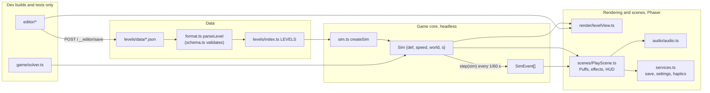

# Architecture

How Hollowdrift is put together, and why. To see the "why" behind each big choice, read
[DECISIONS.md](DECISIONS.md).

## The big picture



The game core (`src/game/`) is a deterministic simulation that knows nothing about Phaser or the
browser. Scenes feed it the player's input (held or not), step it at a fixed rate, and draw what it
holds. Tests and the solver step the same simulation headless.

## Boot

`src/main.ts` waits for three things:

- the bundled fonts (Fredoka and JetBrains Mono, through `@fontsource`)
- saved progress (`platform/storage.ts`, Capacitor Preferences)
- the Box2D WebAssembly module (`game/physics.ts`, `loadBox2D()`)

Then it creates the `Phaser.Game`: 844 × 390, `Scale.FIT`, centred. The scenes, in order, are Title,
World, Map, Play and Clear. In dev builds `main.ts` also does two more things:

- It dynamically imports `editor/EditorScene` and adds it. With `?edit=<id>` in the URL the editor
  starts first, in place of the title.
- It puts `window.__game` (the Phaser game) and `window.__sim` (the sim module) on the page, so that
  headless browser checks can drive any screen.

## Modules

| Module | Responsibility | May depend on |
| --- | --- | --- |
| `config/constants.ts` | Screen, play field, physics, drift, sizes, timings | nothing |
| `config/tuning.ts` | The difficulty ramp `D(n) = 1.01^(n-1)` and the numbers it scales | nothing |
| `config/palette.ts` | Colours and font names from the UI kit | nothing |
| `game/types.ts` | Level data types (`LevelDef` and every object def) | nothing |
| `game/physics.ts` | Loading Box2D, units, collision categories, shape and body builders | box2d3-wasm |
| `game/sim.ts` | The simulation: building a world from a level, stepping it, events, snapshots, the run's clock | config, physics, types |
| `game/solver.ts` | Beam-search player over snapshots (tests only) | sim |
| `game/progress.ts` | Save data as pure functions: records, unlocks, worlds | levels, types |
| `game/geometry.ts` | Small 2D helpers (`circleTriangle`, which the HUD uses to tell when it sits over dark ground) | nothing |
| `game/levels/schema.ts` | Every level field, with validation | types |
| `game/levels/format.ts` | JSON file ⇄ `LevelDef` (hex colours, canonical layout) | schema |
| `game/levels/lint.ts` | Design checks (playable-but-bad layouts) | schema, sim geometry |
| `game/levels/index.ts` | Loads the level files into `LEVELS`; `levelById`, `nextLevel`, `replaceLevel` | format |
| `render/levelView.ts` | Draws a level as it stands in a sim; shared by play and the editor | sim (read-only), art |
| `render/art.ts` | Drawing primitives: Puff, sky, sun, wheel, crusher, orb, seed, bloom, burrow, spikes | palette |
| `render/ui.ts`, `render/panels.ts` | UI kit (labels, buttons, toggles, seed dots, scene fades), settings and toasts | palette |
| `scenes/*` | Screens and the game loop | everything above |
| `editor/*` | Level editor (dev only) | levels, sim, render |
| `audio/audio.ts` | Web Audio: ambience, music box, effects | nothing |
| `platform/*` | Capacitor Preferences (saves) and Haptics | Capacitor |
| `services.ts` | App-wide state shared by scenes: save, settings, buzz | progress, audio, platform |

Dependencies point down this table. `src/game/` never imports from `render/`, `scenes/`, `editor/`,
`audio/` or `platform/`.

## The simulation (`src/game/sim.ts`)

### Data

- `LevelDef` (`types.ts`) is plain data, loaded from JSON. The sim never changes it.
- `Sim = { def, speed, world, s }`. Here `world` holds the Box2D handles, which are fixed after
  `createSim`, and `s: SimState` holds everything that changes: phase, time, scroll, Puffs, and the
  state of each prop, pickup and checkpoint.
- `SimView = Pick<Sim, 'def' | 's'>` is all that drawing needs. `poseSim(def, t)` builds a SimView with
  no physics. The editor uses it.

### Box2D

- **Units:** 1 m = 30 pt (`PT`, `m()`). Gravity is 300 pt/s² downward.
- **Collision categories** (`physics.ts` `CAT` and `MASK`): `terrain`, `prop` (logs, gates, crusher
  bodies), `pebble`, `hazard`, `puff` and `sensor`.
  - A Puff's solid body collides with terrain, props and pebbles. Its sensor, a circle 3 pt smaller
    than the body, only senses hazards, so a graze is forgiven.
  - Puffs never collide with each other: `puff` and `sensor` shapes share group index −1.
- **Bodies:**
  - Static ground holds the blocks, mounds, briar and the roof and floor.
  - Logs are dynamic planks on revolute joints with limits. Motors drive the beat logs and hold the
    heavy ones.
  - Gates, curtains, crushers and wheels are kinematic. They move by velocity (`moveY`), never by
    teleporting.
  - Pebbles are dynamic: circles for pebbles, octagons for boulders.
  - There's a fixed pool of 6 Puff bodies, which are enabled as needed. Bodies are never created
    after `createSim`.
- **Tags:** shapes map to meaning (`solid`, `hazard` with a cause, `pebble`, `puff`, `sensor`) in
  `world.tags`, keyed by `shapeId.index1`. Box2D user data doesn't survive a snapshot; the index does.
- **Snapshots:** `snapshot(sim)` copies `SimState` and serializes the Box2D world. `restore` puts both
  back exactly. The solver relies on this, and `sim.test.ts` tests it under "determinism".

### One step (`step(sim)`, every `SIM_STEP` = 1/60 s, 4 substeps)

1. Record the held state, which clones replay 80 ms late. A `waiting` sim starts on the first hold.
2. `driveProps`: log tipping, returning and beat motors, the heavy-log lock, gates, curtains, wheel
   spin, and crusher beats (`crusherState`).
3. `drivePuffs`: lift while held, and the forward drift toward screen x 280, with catch-up and
   slow-down. Clones also get a pull back to their slot in the flock.
4. `b2World_Step`, then `readBack` copies positions and velocities into `SimState`.
5. `readEvents`: hazard sensor hits mark Puffs as lost. Contacts make bumps, pebble pushes and wheel
   jams.
6. `scroll`: the camera advances at the level's speed. A Puff left of `camX + EDGE_KILL` is lost.
7. Remove lost Puffs. If the leader was lost, the next clone takes the lead. If every Puff is lost:
   - `deaths: 'instant'`: re-form at the last bloom after 0.4 s, then wait for a hold.
   - `deaths: 'screen'`: the phase becomes `failed`, which shows the fail screen.
8. `resize` (Swell and Shrink wearing off), `collectPickups` (seeds, Split bubbles, orbs),
   `checkBlooms` (checkpoints).
9. Win when the front Puff reaches `burrowX`.

The step returns `SimEvent[]` (`tip`, `gate`, `seed`, `lost`, `slam`, `win` and so on). `PlayScene` turns
events into sound, haptics and particles. Events never feed back into the sim.

### Badland rules

The screen scrolls by itself. Puff drifts toward its spot at screen x 280 (`PUFF_SCREEN_X`), and the
player only controls its height. A Puff is lost when its sensor touches a hazard (briar, a thornwheel,
a rootcrusher's underside, a thorn curtain) or when the left edge of the screen passes its centre.
Bumping into anything else only slows it.

### The run's clock

`arrivalTime`, `placeAtTime` and `camAtTime` map between time into a run and position, for a Puff
keeping its place on screen. They include the scroll's 0.5 s linger at the first bloom, for levels
that have one. `createSim(def, t0)` starts a sim partway through a run, with crushers, wheels and beat
logs where a full run would have them; editor test flights use it.

## Rendering

- **Layers** (`render/levelView.ts` `DEPTH`), from the back:
  - `sky` (L0, fixed)
  - `far` (L1 hills at 0.2× and L2 hills at 0.5× parallax)
  - `world` (the play layer)
  - `labels`
  - `puffs`
  - `fx`
  - `fore` (L4 at 1.4×, plus the left-edge shadow)
  - `overlay`
  - `hud`
- `LevelView.draw(sim, camX, t)` redraws the play layer each frame from `def` plus `s`.
  `setLevel(def)` redraws the sky and labels only when they change.
- `PlayScene` draws Puffs (`art.ts` `drawPuff`, which has the states drift, puff, bonk, sleep and lost),
  particles and the HUD. It also handles pause, fail and win.
- Everything is Phaser `Graphics` and `Text`; there are no textures. The palette and fonts come from the
  boards' UI kit.

## Scenes and screens

`title → world → map → play → clear`. Pause and fail are overlays inside `play`. Scene changes go through
`ui.ts` `go()`, which fades out, disables input meanwhile, then starts the next scene. In dev builds,
`editor` can be reached from three places: `?edit=<id>`, the **Edit** button on the map, and **E**
during play.

## Levels pipeline

```
data/<id>.json --parseLevel--> LevelDef --createSim--> Sim
       ^                           |
       +------formatLevel----------+   (the editor saves through the dev server)
```

- `parseLevel` turns `"#rrggbb"` sky colours into numbers, validates against `schema.ts`, and throws
  with every problem listed.
- `formatLevel` writes keys in schema order, rounds numbers to 3 decimals and keeps short lists on one
  line, so a diff shows only what changed.
- `lintLevel` reports design problems: Puff spawning inside ground, a gate out of sight of its log, a
  heavy log with no Swell before it, a bramble too tight to pass, a crusher with no clear drop, and so
  on. The tests require every shipped level to have none. The editor shows them live.

## The solver (tests only)

`solver.ts` plays a level by beam search over hold-or-release decisions every 0.1 s by default.

- It keeps the best nodes per "band" (height, size and flock count), so that low, high and swollen
  lines all survive.
- It scores progress capped at the scroll's pace, plus seeds, clones and closeness to the designer's
  route, if the level has one.
- When a run fails on a fail-screen level, it retries from the checkpoint.

Because the sim is deterministic, a plan the solver finds is a real playthrough. The slow tests in
`levels/solvable/` use it to prove each level can be finished, each seed collected and each badge
earned.

## The level editor (dev only)

- `EditorScene` is a thin Phaser scene. `Editor` holds the state and handles input. It draws through
  `LevelView` from `poseSim(def, t)`, so the editor shows exactly what the game shows at that moment.
- `model.ts` is pure: the working copy, undo and redo (each `begin()`/`end()` pair is one step),
  ID-safe renames, and add, delete and duplicate.
- `shapes.ts` is pure: per-kind bounds, hit tests, handles, moves and handle drags.
- `panel.ts` is plain DOM around the canvas: toolbar, forms generated from `schema.ts`, timing charts,
  problems, minimap and clock.
- Saving sends `POST /__editor/save` to the Vite plugin in `vite.config.ts`. The plugin only writes an
  existing `data/<id>.json`, and skips the page reload for its own writes.
- Sessions survive test flights and switching levels. Drafts survive a reload, kept in localStorage
  against the file they started from.

## Persistence, audio and platform

- `progress.ts` is pure functions over `SaveData` (version 1): level records (best seeds, best home,
  badge, best time), unlocks, and world unlocks by total seeds.
- `platform/storage.ts` stores the save in Capacitor Preferences (UserDefaults on iOS), best effort.
- `audio/audio.ts` synthesizes everything with Web Audio: wind and crickets, a music box that adds a
  voice per living clone, and effects. iOS needs `unlock()` on the first touch.
- `platform/haptics.ts` triggers haptics through Capacitor. It's off by default and does nothing in a
  browser.

## Build and deploy

- Vite bundles to `dist/`, and the box2d3-wasm `.wasm` (about 612 kB) is emitted as an asset.
- `capacitor.config.ts` (`webDir: 'dist'`) wraps the build for iOS. The `ios/` project isn't in the
  repo yet; [playbooks/release-ios.md](playbooks/release-ios.md) covers generating it.
- The compat build of Box2D needs no SIMD, threads or cross-origin isolation, so it runs in
  WKWebView.

## Extension points

- **A new mechanic:** [playbooks/new-mechanic.md](playbooks/new-mechanic.md) walks through the files it
  touches, in order.
- **A new level or chapter:** [playbooks/level-change.md](playbooks/level-change.md).
- **A new screen:** add a scene, register it in `main.ts`, and move between scenes with `go()`. Build
  the UI from `ui.ts` and the palette.
